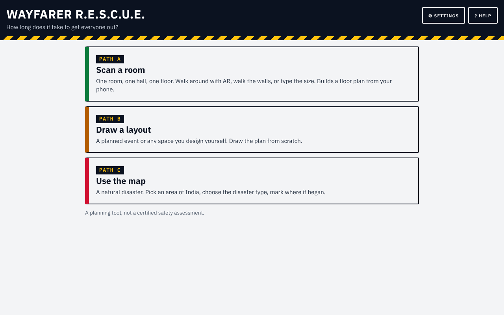
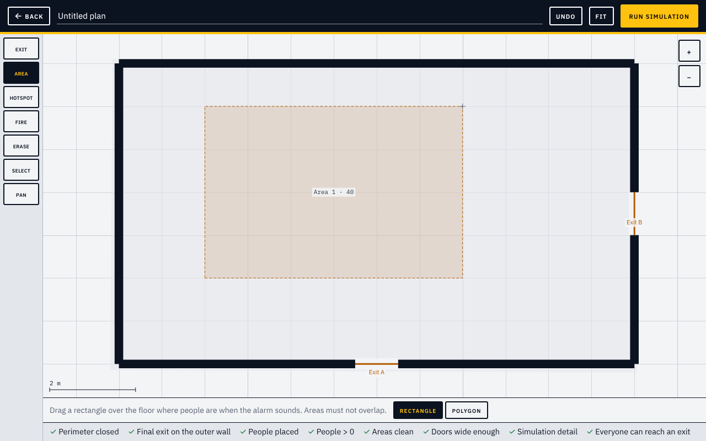
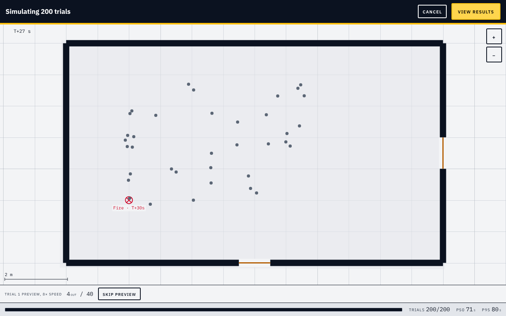
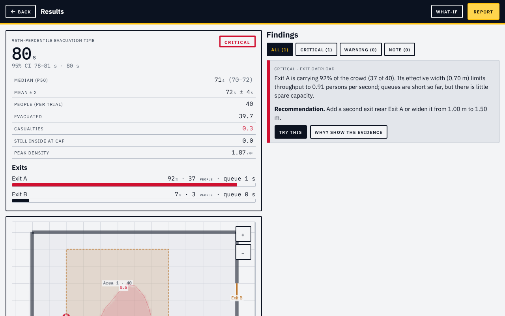
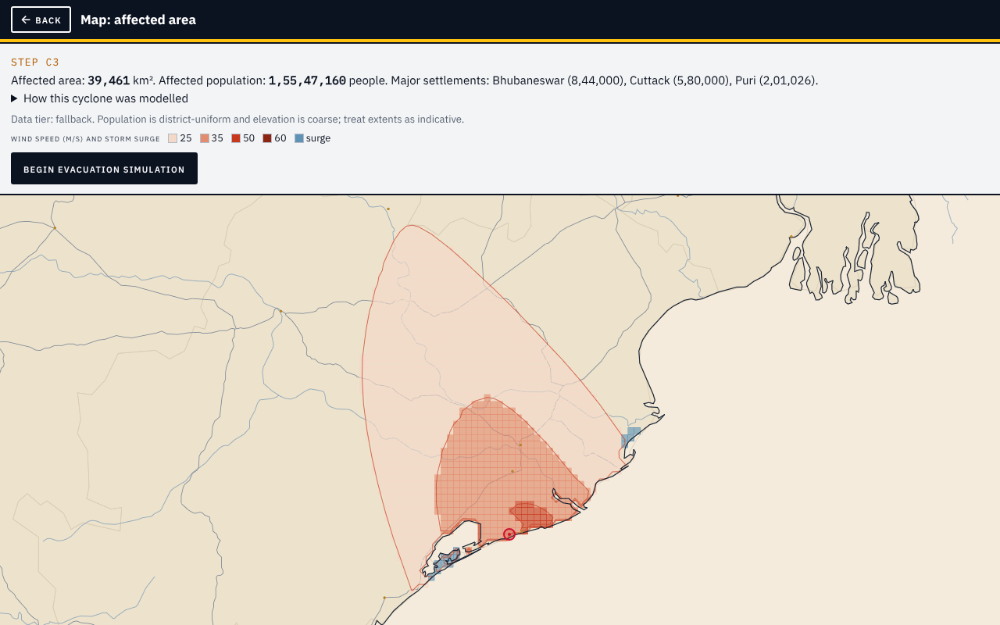
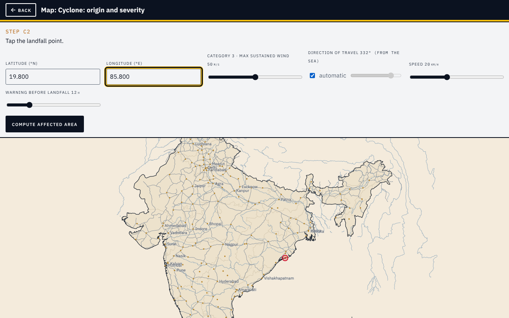
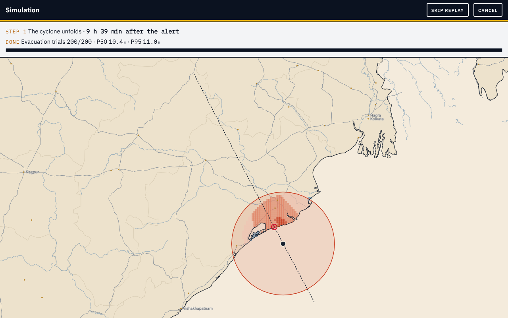
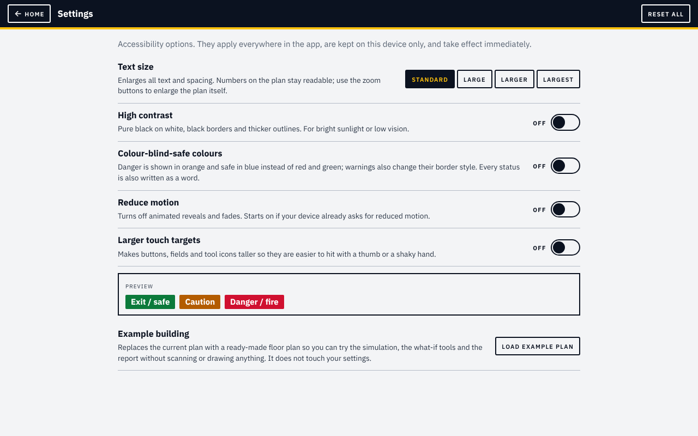

<div align="center">

# WayFarer R.E.S.C.U.E.

**Rapid Evacuation Simulation via Computational Understanding of Environments**

*How long does it take to get everyone out?*

An offline-first web app that models how a crowd leaves a building, and how a region evacuates after a cyclone,
flood or earthquake. Runs entirely in the browser. No server, no account, no tracking.

     



</div>

---

## Preface: the competition

This project is an entry to the **CBSE Science Exhibition** (see CBSE Circular No. 69 of 2026).

| | |
|---|---|
| **Theme** | STEM for Science, Technology, and Innovation for a Sustainable and Vikshit Bharat |
| **Sub-theme** | Mathematical Modelling and Computational Thinking |
| **Category** | II (Classes 9–11) |
| **School** | Apeejay School, Saket, New Delhi |
| **Class** | IX |
| **Team** | Nikhil Shukla and Hitarth Bisht |

**Why this problem.** Evacuation plans for buildings, venues and whole districts are mostly written by estimation, and
their weaknesses are found only in an emergency. Real drills are costly and cannot be repeated freely; professional
simulation software is expensive and needs training. WayFarer R.E.S.C.U.E. puts a mathematically honest model in a
free web page, so a school, an event organiser or a student can ask "what if?" before anything goes wrong.

**Why it fits the sub-theme.** Every number on screen comes from a stated model: a published walking-speed curve, a
wave-front travel-time equation, queueing at doors, a t-squared design fire, standard cyclone, earthquake and
rainfall-runoff relations, and 200 random trials with confidence intervals. The computational thinking is in how the
real world is reduced to a grid, a graph and a set of rules, and in checking that the model conserves people.

> **A planning aid, not a certified safety assessment.** See [Limitations](#limitations-and-honest-caveats).

---

## Contents

1. [What it does](#what-it-does)
2. [Screenshots](#screenshots)
3. [Run it](#run-it) · [Publish on GitHub Pages](#publish-on-github-pages)
4. [The three paths](#the-three-paths)
5. [How the model works](#how-the-model-works)
6. [Accessibility and settings](#accessibility-and-settings)
7. [Project layout](#project-layout)
8. [Testing](#testing)
9. [Limitations and honest caveats](#limitations-and-honest-caveats)
10. [Roadmap](#roadmap)
11. [Credits, data and references](#credits-data-and-references)

---

## What it does

* **Describe a place** by scanning a room, drawing a floor plan, or choosing a disaster on a map of India.
* **Mark** where people are (areas and hotspots), where the exits are, and where a fire or other hazard begins.
* **Simulate** 200 seeded random evacuations and watch the first one play out.
* **Read the result:** median and 95th-percentile evacuation time with confidence intervals, how heavily each exit is
  used, where the crowd is densest, who does not get out, and plain-language findings with the evidence behind each.
* **Try a change** (a wider door, a second exit, an earlier warning) and see the paired before/after comparison.
* **Take it away** as a printable report or a JSON file.

For regional disasters the app also estimates the affected area and population, decides who is ordered to leave, moves
them along the road network and assigns them to shelters, respecting shelter capacity.

## Screenshots

| Choose a way in | Four ways to scan a room |
|:--:|:--:|
|  |  |

| Mark people, exits and the fire | Fire and smoke spreading through the room |
|:--:|:--:|
|  |  |

| Results with evidence-backed findings | The cyclone footprint on the map |
|:--:|:--:|
|  |  |

| Setting up a disaster | Hazard replay with a clock |
|:--:|:--:|
|  |  |

| Settings (accessibility) | Help and how-to guide |
|:--:|:--:|
|  |  |

---

## Run it

Requires Node.js 20 or newer.

```bash
npm install
npm run dev          # http://localhost:5173
npm run build        # type-check + production build into dist/
npm run preview      # serve dist/ at http://localhost:4173 (service worker active)
npm test             # unit tests (Vitest)
npx playwright install chromium
npm run test:e2e     # builds, serves and drives the real app in a browser
npm run lint
```

> The camera and motion sensors work only on `https://` pages (and `localhost`). On a phone, use the deployed GitHub
> Pages address, not a plain `http://` link to your computer.

### Publish on GitHub Pages

1. Create a **public** repository (for example `wayfarer-rescue`) and push this folder to its `main` branch.
   Make sure the hidden folder `.github/` is included; use `git` or GitHub Desktop, not the web uploader.
2. **Settings → Pages → Build and deployment → Source: GitHub Actions.**
3. The workflow `.github/workflows/pages.yml` runs the tests, builds with the repository name as the base path and
   publishes `dist/`. In **Actions**, wait for both jobs to turn green.
4. The site is at `https://<user>.github.io/<repository>/`.

The build detects the repository name by itself inside GitHub Actions (or from `VITE_BASE`), writes a `404.html`
fallback so that reloading a deep link works, and adds `.nojekyll`. Plans are stored in the browser (IndexedDB) and
settings in `localStorage`; nothing leaves the device. After one online visit the app works with the network off.

---

## The three paths

### A. Scan a room → `/scan`

Four ways, all ending in the same plan:

| Method | How | Works on |
|---|---|---|
| **AR walk-around** | WebXR hit-test: walk to each floor corner and tap *Place corner*. The phone tracks its own movement, so large halls are fine. | Android, Chrome, ARCore |
| **Walk along the walls** | Step counting from the accelerometer plus the compass. Tap at each corner, return to the start; the loop is closed and, optionally, squared to right angles. | Any phone with motion sensors |
| **Type the size** | Rectangle or L-shape from its measurements. Exact. | Anywhere |
| **Aim from one spot (any camera)** | Stand still, enter phone height, aim at each floor corner and tap (gyroscope pitch gives distance). | Phones; every corner must be in view |

iPhones and iPads do not support WebXR in a web page, so the AR option is offered only where the browser supports it.
After scanning you can fix the scale with one measured distance, or skip that step.

### B. Draw a layout → `/draw`

Walls, doors, people areas and hotspots on a pan-and-zoom canvas. The outer perimeter is detected automatically and its
doors become the final exits; interior doors are not exits. People areas cannot overlap or cross themselves.

### C. Use the map → `/map`

Choose a disaster, tap the origin on the map of India and set its strength:

| Disaster | Inputs | Plausibility check |
|---|---|---|
| **Cyclone** | category, heading, forward speed, warning time | must begin at sea |
| **Flood** | 24-hour rainfall (mm) | refused where that much rain is implausible (e.g. 300 mm in the Thar) |
| **Earthquake** | magnitude, fault direction | refused above what the regional faults can produce |

The affected area is computed and replayed over about ten seconds with a clock, then the evacuation is simulated.

---

## How the model works

### Inside a building

| Part | Model |
|---|---|
| **Walking speed** | Weidmann (1993) speed–density curve, scaled per person (adult, child, older adult, wheelchair user). |
| **Routing** | First-order **Fast Marching Method** solves the eikonal equation for travel time from each exit (Sethian 1996); people descend it on an 8-neighbour grid, and choose exits with queue awareness. |
| **Doors** | SFPE effective width (door width − 0.3 m) × 1.3 persons per second per metre, as a first-in-first-out queue. |
| **Pre-movement** | Log-normal reaction delays; people standing in smoke stop waiting after about five seconds. |
| **Fire** | *t-squared* design fire, Q = αt² (NFPA 72 / SFPE, "fast" α = 0.0469 kW/s²), fuel-limited. Flames follow the burning area. |
| **Smoke** | Spreads at the Alpert (1972) ceiling-jet speed, u = 0.195 Q^(1/3) H^(1/2) / r^(5/6), **through open space only**: it stops at walls and flows through doors. Smoke halves walking speed (Jin 1978) and harms by exposure time, like a fractional effective dose (ISO 13571); the dose rate falls with distance from the fire. People who are cut off keep accumulating dose. |
| **Monte Carlo** | 200 seeded trials (mulberry32), bootstrap confidence intervals (1000 resamples). The same seed always gives the same answer. Every run checks conservation: people in = out + dead + still inside. |
| **Groups** | About 70 % of pedestrians walk in groups, mostly pairs (Moussaïd et al. 2010). Companions start together, wait for the slowest to be ready (plus an assumed 5 s), walk at the slowest pace and leave by the same exit. |
| **Findings and summary** | A rule table over the results; each finding carries its evidence in plain words. The *What happened* card is written from the run itself: it tests whether reaction time, queueing or distance limited the result and says which, with the figures. There is a trained estimator and an optional on-device language model (see below). |
| **Estimator (AI)** | A small neural network (11 inputs → 32 → 32 → 3 outputs, in `src/ai/`) trained by `scripts/surrogate/` on 1,672 random rooms, each run through this simulator. Inputs are physical: crowd size, walking times to the exits, door capacity, alarm delay, fire distances, vulnerable share. It predicts P50, P95 and the share lost in milliseconds, shown while marking and as a cross-check on the results. Held-out error is about 12 % on P95 (84 % of rooms within 20 %); a plain linear fit gets 14 %. It learns the simulator, not reality, and flags rooms outside its training range (up to about 1,400 people). |
| **Language model (optional)** | If the browser has WebGPU, a button re-words the summary using a small general model (Qwen2.5-0.5B, about 0.4 GB, downloaded once, then offline). It is not fine-tuned; a check rejects any wording that changes or adds a number. |
| **What-if** | Re-runs a suggested change with the same seed for a paired comparison. |

### Across a region

| Part | Model |
|---|---|
| **Cyclone** | Holland (1980) wind profile; Willoughby–Rahn radius of maximum wind; Atkinson–Holliday pressure–wind relation; Kaplan–DeMaria inland decay; Saffir–Simpson storm surge decaying 0.35 m per km inland; translation asymmetry. The eye moves along its heading; the footprint is the swept area with an arrival time per cell. |
| **Earthquake** | Wells & Coppersmith (1994) rupture length, distance to the whole fault, Worden et al. (2012) shaking intensity, S-wave arrival time. |
| **Flood** | SCS Curve Number runoff, Priority-Flood drainage (Barnes 2014) on the elevation grid, Leopold–Maddock stage, rising-limb hydrograph; onset delayed by half the time to peak. |
| **Who leaves** | Severity decides who is ordered out or trapped; everyone else shelters in place. |
| **Movement** | Evacuees travel the road graph (first-in-first-out queues, roads closing as the hazard arrives) to a refuge just outside the footprint. |
| **Shelters** | A capacity-constrained greedy assignment to the nearest shelter with room within range; overflow is reported, not hidden. |
| **Population** | Counted automatically from the census grid inside the affected area. |

Every parameter is in `src/constants.ts` or `src/engine/disaster/params.ts`, with its source or marked **ASSUMED**.
`DEVIATIONS.md` lists every place the build differs from the original written specification, and why.

---

## Accessibility and settings

Settings (⚙) apply instantly and are stored on the device: four text sizes, high contrast, a colour-blind-safe palette,
reduced motion, and large touch targets. Danger and safety are never shown by colour alone. The Help page (?) has the
exhibition description, a how-to guide, and the build details that used to clutter the home page.

## Project layout

```
src/engine/            speed, doors, fast marching, grid, hazards (fire and smoke), agents, Monte Carlo (+ web worker)
src/engine/disaster/   cyclone, earthquake, flood, hydrology, climate, evacuation orders, road graph, shelter plan
src/scan/              AR (WebXR), step-counting, typed size, one-spot camera, calibration
src/draw/ marking/     floor-plan editor and validation
src/simulation/        live preview (flames, smoke, people)      src/results/  results, what-if
src/map/               map wizard, MapLibre map, overlays, data loader
src/ai/                finding rules, evidence, situation summary, trained estimator, optional language model
src/report/            printable report and JSON          src/demo/  built-in example plan
public/data/           census grid, roads, rivers, shelters, boundaries (4.7 MB)
scripts/               data pipeline; surrogate/ trains the estimator (generate.ts, train.py, data/)        e2e/  browser tests       docs/images/  screenshots
DEVIATIONS.md          where the build differs from the written specification, and why
```

## Testing

* **128 unit tests** (Vitest): door flow, fast-marching accuracy, conservation of people, fire and smoke fronts,
  hazards, cyclone/earthquake/flood models and plausibility refusals, evacuation orders, shelter assignment, step
  counting, loop closing, finding rules.
* **25 browser tests** (Playwright, Chromium): drawing, all scan paths (with emulated sensors and a stand-in WebXR),
  the map paths, offline use after one visit, report and print-to-PDF, settings, and layouts at phone and desktop width.

---

## Limitations and honest caveats

* **Data tier.** The preferred high-resolution datasets were not reachable when this was built, so the app ships a
  fallback tier: Census 2011 district population spread *uniformly* over each district, elevation at about 18 km
  effective resolution, a skeleton of major roads, and rivers as centre-lines. Flood and surge extents, shelter loads
  and road bottlenecks are **indicative**. The app and the report say so.
* **Assumptions, not calibration.** Shelter capacity is assumed to be 10 % of a town's population; the shares of people
  ordered to leave, the fuel-limited peak fire size, and the smoke dose times are assumptions. The model has not yet
  been calibrated against recorded evacuations. Regional "caught on the way" totals for large cyclones are sensitive to the warning time and
  should not be quoted as deaths.
* **The "last person out" time** is dominated by the pre-movement delay, not by roads or exits; a longer warning
  usually saves far more people than any shelter.
* **Not yet verified on real hardware:** the AR and step-counting scans on a real phone (they were tested with emulated
  sensors and a stand-in WebXR session), real iOS Safari behaviour, the optional language model (no WebGPU was available when building), and the live GitHub Pages deployment.
* **No licence has been chosen yet**, so by default all rights are reserved by the authors.

## Roadmap

**Done in V3**
- [x] Fire spread in the simulation (geometry-aware flames and smoke)
- [x] Camera scanning rebuilt: lens-independent crosshair aim with averaging and an honest ± per corner, depth sensing requested in AR where the phone has it
- [x] AI: a trained estimator tuned to this simulator, a situation-specific summary, and an optional on-device language model re-wording it
- [x] Group behaviour in crowds
- [x] Regional fixes: shelters only proposed nearby, overflow reported as unhoused, "caught on the way" is not a death count, 24 h default warning
- [x] Disclaimers and development notes moved to Help

**Next**
- [ ] Verify AR, depth and walking scans on real phones
- [ ] Calibrate crowd behaviour and the regional model against recorded drills and evacuations
- [ ] Higher-resolution data tier (population grid, elevation, road network)
- [ ] Forest-fire model

**Later**
- [ ] Research paper / binder, presentation and script, accompanying materials
- [ ] Native apps: iOS, Windows, macOS, Android

---

## Credits, data and references

**Built by** Nikhil Shukla and Hitarth Bisht, Class IX, Apeejay School, Saket.

**Data:** Census of India 2011 (district population); NOAA ETOPO1 global relief; Natural Earth (boundaries, roads,
rivers, populated places; public domain).

**Software:** React, TypeScript, Vite, React Router, Zustand, MapLibre GL JS, `idb`, `vite-plugin-pwa` (Workbox),
Vitest, Playwright, IBM Plex fonts, WebLLM (optional); scikit-learn only to train the estimator.

**Scientific references**

* Weidmann, U. (1993). *Transporttechnik der Fussgänger.* ETH Zürich.
* *SFPE Handbook of Fire Protection Engineering*, egress and door flow.
* Sethian, J. A. (1996). A fast marching level set method for monotonically advancing fronts. *PNAS* 93.
* Alpert, R. L. (1972). Calculation of response time of ceiling-mounted fire detectors. *Fire Technology* 8.
* Jin, T. (1978). Visibility through fire smoke. *Journal of Fire & Flammability*; ISO 13571 (life-threatening components of fire).
* Holland, G. J. (1980). An analytic model of the wind and pressure profiles in hurricanes. *Monthly Weather Review* 108.
* Willoughby, H. E. & Rahn, M. E. (2004). Parametric representation of the primary hurricane vortex. *Monthly Weather Review* 132.
* Kaplan, J. & DeMaria, M. (1995). A simple empirical model for predicting the decay of tropical cyclone winds after landfall. *J. Applied Meteorology* 34.
* Wells, D. L. & Coppersmith, K. J. (1994). New empirical relationships among magnitude, rupture length, and surface displacement. *BSSA* 84.
* Worden, C. B. et al. (2012). Probabilistic relationships between ground-motion parameters and Modified Mercalli Intensity. *BSSA* 102.
* USDA Soil Conservation Service (1972). *National Engineering Handbook, Section 4: Hydrology* (Curve Number).
* Barnes, R., Lehman, C. & Mulla, D. (2014). Priority-flood: an optimal depression-filling and watershed-labeling algorithm. *Computers & Geosciences* 62.
* Central Board of Secondary Education, Science Exhibition guidelines, Circular No. 69 (2026).

---

<sub>WayFarer R.E.S.C.U.E. is a planning and learning tool. Its results are estimates from a simplified model and must
not be used to certify the safety of a building or to direct a real emergency.</sub>
